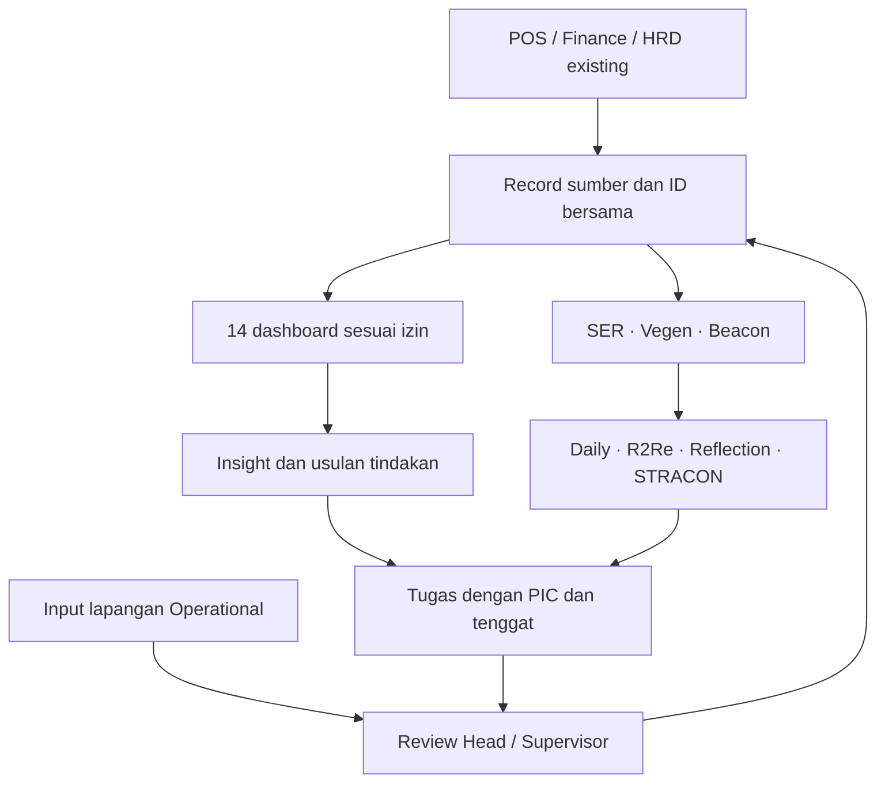

# NP-OP01 · ADDENDUM A02
## Operational Dashboard Parity, Data Entry & Hospitality Manager

**Owner:** Aji Jaens Suputtra · **Tanggal:** 19 November 2026, WITA  
**Status:** koreksi cakupan + prototipe frontend; bukan deployment atau aktivasi backend.  
**Melengkapi:** NP-OP01, NP-FE-OP01, A01 dan 12 fase F-OP00–F-OP11.  
**Prioritas:** F-OP02 Dashboard, F-OP08 SER/RACE, F-OP10 Reports; role pada F-OP01; validasi pada F-OP11.

## 1. Keputusan Owner yang harus dijaga

Semua 14 dashboard dari Operational Report New harus tersedia di Operational Portal dan dapat diklik sampai detail sumber. Susunan dan kebiasaan membaca laporan dipertahankan. Setiap dashboard mempunyai jalur data entry atau jalur menuju sistem sumber yang tepat. Setiap diagram mempunyai insight dan acuan penilaian. Tambahkan **Hospitality Manager: Jro Okta**, dengan model dashboard yang sama, cakupan dan tindakan sesuai peran.

POS & Receptionist tetap menuju POS existing, termasuk Dashboard POS dan Appointment Book. Sales Reservation Center dan CRM tetap menggunakan engine booking POS yang sama. Finance memiliki Accounting, Purchasing dan Inventory. Attendant mencatat pemeriksaan fisik, Supervisor memverifikasi, engine Inventory mem-posting. Supervisor tetap tepat satu outlet aktif. Eni Restini dan Tika tetap mempunyai cakupan seluruh outlet. Nama resmi outlet: Jaens Spa Ubud Center, Jaens Spa Shanti, Jaens Spa Triloka, Jaens Spa Bisma.

Keputusan ini tidak memberi hak otomatis untuk refund, price override, payroll nominal, posting jurnal/stok, atau perubahan permission perusahaan. Tidak ada perubahan reporting line organisasi yang disimpulkan hanya karena penambahan role Hospitality Manager.

## 2. Koreksi hasil sebelumnya

Audit UI terhadap preview yang diberikan Owner menemukan Command Center kegiatan harian, 10 contoh indikator, 3 konsep Beacon, X-Score menunggu kontrak, dan Reports & evidence dengan tiga tab ringkasan/review/log. Itu belum mencakup 14 laporan Looker.

Kesenjangan juga terdapat pada brief/prototipe awal: reference-register REF-011/012 menyatakan workbook dan Looker belum diverifikasi. Empat layar Team & Access yang dibahas sebelumnya bukan cakupan dashboard kinerja. Koreksi ini menggantikan asumsi “sumber belum diterima” dengan hasil pemeriksaan sumber tanggal 19 November 2026. Developer tidak diminta menebak dashboard dari empat KPI Command Center atau sepuluh indikator contoh.

**Batas bukti:** isi UI dan workbook telah diperiksa; formula calculated field Looker, konfigurasi konektor, kontrak endpoint, data production dan rekonsiliasi engine belum diaudit dalam pekerjaan ini. Angka pada prototipe baru adalah sintetis, terpisah dari nilai workbook dan screenshot Owner.

## 3. Referensi yang menjadi baseline

1. Preview yang diaudit: https://hawk-jaens-preview-git-claude-proj-90a77f-jaens-enterprises-pro.vercel.app/hawk-live/operational
2. Laporan sumber: https://datastudio.google.com/reporting/82810819-9efc-4576-bcc5-91be28c8e414 — **Operational Report New, 14 halaman**.
3. Workbook: https://docs.google.com/spreadsheets/d/1TqR4c8TzVNawN2W7xtBvAoHgey4JDuV2/edit?gid=419957531#gid=419957531 — file Office asli **10. Oktober 2026.xlsx**.
4. Screenshot 14 dashboard yang dikirim Owner pada percakapan ini.
5. Brand/shell HAWK: https://preview.hawk.jaens.id/#/nv/47
6. POS existing: https://preview.jaens.id/rnd-demo

File `looker-page-inventory.json` berisi URL tiap halaman dan label UI yang benar-benar terlihat. File `SER-Operational-Source-Inventory.json` berisi nama, satuan, bobot domain, formula sumber dan binding sel; tidak menyalin nominal target/actual finansial. `SER-Operational-Source-Audit.md` menjelaskan hitungan dan temuan formula.

## 4. Register 14 dashboard dan sumber data

Setiap baris adalah satu halaman laporan, bukan satu widget atau satu fitur backend baru. Full-report parity pada preview yang diaudit: **belum ditemukan untuk 14/14 halaman**. Beberapa metrik generik sudah muncul di area lain; itu tidak menggantikan isi halaman sumber.

| ID | Dashboard / nama yang dikenal tim | Blok visual yang wajib dipetakan | Sumber dan entry | Pemilik proses |
|---|---|---|---|---|
| OP-D01 | Revenue Overview | Total/service/retail/avg per day; tren; komposisi; outlet bar; pencapaian target empat outlet | Invoice layanan dan retail POS; target Finance. Tidak menginput total revenue kembali | Reception/POS; Finance target; Manager review |
| OP-D02 | Profit & Loss | Revenue, expense, net profit, variance; kontribusi; profit per outlet; tren profit; tabel P&L; expense per outlet | Finance/GL dan alokasi biaya; Ops mengajukan aktivitas/biaya melalui workflow sumber | Finance; Manager membaca hasil outlet |
| OP-D03 | Capacity & Productivity | Room revenue; utility/day/person; absensi; room category; utility/absence composition; room revenue per outlet | Appointment/room/treatment POS + shift/presensi HRD + room readiness | Reception, Therapist, Supervisor; HRD untuk presensi |
| OP-D04 | Waste & Accuracy | Total/BHP/retail waste; accuracy; tren; komposisi YTD; tabel waste dan opname | Catatan fisik waste, alasan, bukti, hasil opname; stok buku dan valuation dari Inventory | Attendant input; Supervisor verifikasi; Inventory posting |
| OP-D05 | Customer Review & Satisfaction | Online/offline review; satisfaction/complaint offline; tren feedback; kontribusi online/offline; distribusi bintang; platform | Satu record feedback/review, kanal, rating, bukti dan appointment reference bila ada | Reception; Head Reception; Hospitality Manager |
| OP-D06 | Customer Satisfaction & Complaints | Satisfaction/complaint percentage; rating; star achievement; satisfaction vs complaint; outlet contribution | Membaca record feedback yang sama dengan D05; definisi denominator harus eksplisit | Reception dan Hospitality Manager |
| OP-D07 | Rebooking & Customer Retention | Total/new/repeat customer; rate; outlet count; kontribusi rebooking; tabel outlet | Customer/visit/booking ID POS dan CRM; unik, tanggal kunjungan dan klasifikasi versi | Sales/Reception; Hospitality Manager review |
| OP-D08 | Complain Handling Performance | Total; resolusi sesuai SLA/terlambat; rata-rata waktu; outlet, sumber, kontribusi; detail kasus | Case ID, kanal, kategori, waktu diterima/ditanggapi/diselesaikan, PIC, tindakan dan bukti | Reception; Supervisor; Hospitality Manager |
| OP-D09 | Tripadvisor Performance | Rank, rating; kontribusi; tabel outlet; rank per outlet | Snapshot platform, tanggal observasi, rank, rating, jumlah review, bukti/URL; konektor jika tersedia | Hospitality Manager bersama Commercial/Marketing |
| OP-D10 | Maintenance Performance | Jumlah; response time; status; kontribusi outlet; kategori issue per bulan | Ticket/asset/room ID, severity, waktu report/response/resolve, status, evidence | Attendant/maintenance; Supervisor; Finance biaya |
| OP-D11 | Grading FO | Program progress; status; progress tahapan; tabel tahapan/grade/PIC/bobot/status | Milestone program, assessment rubric, evidence, assessor, reviewer | Head Reception; Hospitality Manager; HRD |
| OP-D12 | Team Competency & Readiness | Total karyawan; indeks; Therapist/FO/Attendant score; profil kompetensi | Employee ID HRD + assessment dan evidence per kompetensi | Head departemen; Supervisor; Hospitality Manager; HRD |
| OP-D13 | Grooming Karyawan | Check/not executed; tren harian; outlet comparison; compliance rate | Checklist per orang/shift/tanggal, eligible population, hasil dan verifier | Head departemen; Supervisor; Hospitality Manager |
| OP-D14 | Bisnis Proses | Total/approved/in process; daftar dokumen; kontribusi; completion per role | Document ID, versi, role, owner, stage, due date, approval dan link dokumen | Head/Supervisor; Manager; Hospitality Manager untuk service SOP |

Nama Looker pada navigasi “Capacity & Capability” tampil sebagai “Capacity & Productivity” pada kanvas; kedua label dipetakan ke OP-D03. “Team Competency & Readyness Bisma” adalah halaman sumber outlet Bisma, sedangkan target portal harus dapat memakai template yang sama untuk empat outlet dengan data sesuai assignment. Preserve alias sumber, jangan menganggap tiga outlet lain sudah punya dataset kompetensi yang sama.

## 5. Struktur menu dan interaksi

Pertahankan **Command Center** untuk kendali hari ini. Tambahkan **Dashboard Kinerja** dengan daftar 14 laporan dalam urutan referensi. **AmbideX & RACE** menjadi workspace kontrak, siklus dan review, sedangkan Reports & evidence tetap menangani EOD/log/evidence.

Untuk setiap dashboard:

- Filter outlet, tanggal dan periode; Supervisor tidak mempunyai pilihan outlet lain.
- Klik kartu atau diagram → detail metrik, satuan, denominator, sumber, periode, status data dan versi acuan.
- Klik kategori/outlet → detail data yang mendukung angka, tanpa melewati scope pengguna.
- Tombol **Data & verifikasi** → daftar catatan sumber dan status Draft/Submitted/Review/Verified/Rejected.
- Tombol **Tambah data sumber** untuk proses manual; data yang sudah dimiliki POS/Finance/HRD diarahkan ke sumber resminya.
- Tombol **Insight** pada setiap diagram → penjelasan yang terikat pada filter dan data yang sama.
- Tombol **Standar & target** → acuan, arah nilai, rentang, masa berlaku, pemilik, versi, status approval.
- Tombol tindak lanjut → draft tugas dengan PIC, due date, dashboard/metric/source ID dan evidence link.

Semua aksi prototipe harus bekerja dengan data sintetis lokal. Menyimpan data belum berarti posting production. Jangan membuat tombol kosong yang hanya menampilkan “coming soon” untuk interaksi inti yang dapat disimulasikan.

## 6. Single entry dan workflow lapangan

Input manual minimal memuat outlet, tanggal kejadian/shift, jenis catatan, nilai atau fakta kejadian, unit, source reference, bukti, pembuat dan status verifikasi. Head memeriksa bagian departemennya; Supervisor memberi final assurance sesuai aturan hybrid; Manager/Hospitality meninjau domain yang ditugaskan. Pembuat tidak memverifikasi catatannya sendiri. Record ditolak atau belum verified tidak boleh dianggap capaian final.

Koreksi setelah verifikasi membuat revisi dan alasan, bukan menimpa histori. Dokumen pada periode ditutup tetap memakai versi semula. Rekonsiliasi transaksi, status refund/void, duplicate prevention dan permission harus ditegakkan backend ketika integrasi. Prototype tidak membuktikan kontrol tersebut sudah aktif di ERP.

Contoh: satu feedback offline dicatat Reception lalu diverifikasi. Record yang sama memperbarui D05 dan D06 serta indikator kepuasan/keluhan yang sesuai. Komplain yang perlu penanganan mempunyai Case ID yang ditautkan ke feedback; case resolution memperbarui D08, bukan membuat jumlah review baru. Berakhirnya maintenance tidak otomatis mem-posting biaya atau menyatakan ruang siap tanpa inspeksi readiness.

## 7. AI insight, low/high dan standar

**AI menjelaskan data dan acuan; target bisnis tetap ditentukan manusia yang berwenang.** Warna dan kata “baik” tidak boleh ditentukan hanya karena angka besar atau kecil.

| Jenis metrik | Arah evaluasi | Ketentuan |
|---|---|---|
| Revenue, satisfaction, progress program | Lebih tinggi umumnya lebih baik terhadap target | Bandingkan periode dan exposure yang setara; jelaskan budget/target versi |
| Waste, complaint rate, response/resolution time | Lebih rendah umumnya lebih baik | Tetap cek jumlah aktivitas, kelengkapan pelaporan dan denominator |
| Tripadvisor rank | Nomor lebih kecil lebih baik | Pisahkan dari star rating; rank 1 lebih tinggi posisinya dari rank 30 |
| Room / therapist utilization | Rentang sehat | Kapasitas berlebihan juga berisiko; jangan otomatis menjadikan 100% ideal |
| Donut komposisi outlet/platform/kategori | Deskriptif | Porsi besar bukan otomatis baik/buruk; pisahkan contribution dan rate |
| Grooming/stock accuracy/competency | Sesuai definisi dan standar SOP | Tidak menjumlahkan persentase; agregasi memakai numerator/denominator atau bobot sah |

Per insight wajib ada: ringkasan keadaan; nilai/target/gap; periode/outlet; sumber dan update time; aturan/versi acuan; coverage/quality; dugaan penyebab yang diberi label hipotesis; tindakan yang disarankan; PIC dan tenggat usulan. Jika data atau standar belum cukup, tampilkan **“Belum dapat dinilai”**, bukan mengarang angka normal industri.

UI prototipe memakai **Insight simulasi**, dengan aturan terjelaskan; belum memanggil model AI. Pada tahap backend, service insight menerima hanya data yang lolos scope/field permission, serta definisi dan target berversi. Tidak boleh menyarankan penilaian karyawan, perubahan gaji, refund, posting, atau perubahan standar secara otomatis. Personal KPI tetap melalui review manusia dan konteks data.

Standar sumber yang perlu dirapikan: batas tepat 24 jam; ranking vs rating; persen vs jam; planned vs unplanned absence; denominator guest/review; target musiman. Tunjukkan status Pending/Approved/Expired. Angka demo untuk mencoba setting harus ditandai simulasi dan tidak menggantikan kontrak sumber.

## 8. Matriks peran tambahan

| Peran | Scope dashboard | Input / review | Batas |
|---|---|---|---|
| Eni Restini · Operational Manager | Seluruh 14, empat outlet | Kontrak/standar dalam kewenangan, review, prioritas, eskalasi | Finance/HRD posting dan hak sensitif tetap terpisah |
| Tika · Assistant Spa Manager | Seluruh 14, empat outlet | Delegasi Manager, koordinasi dan review | Dalam batas delegasi |
| Jro Okta · Hospitality Manager | Model14 yang sama, outlet yang ditugaskan; prototipe 4 outlet | Kualitas layanan, review/complaint, FO grading, grooming, readiness, service SOP dan coaching | Tidak memperoleh payroll nominal, price override, refund, stock/GL posting atau settings.manage otomatis |
| Supervisor Ubud/Shanti/Triloka/Bisma | Seluruh 14 untuk tepat 1 outlet | Verifikasi operasional, prioritas, tindak lanjut | Tidak lintas outlet |
| Head departemen | Data dan input departemen/outlet yang ditugaskan | Review awal sesuai policy | Tidak menyetujui sendiri; kritis diteruskan |
| Reception/Therapist/Attendant/Security | Halaman dan entry relevan, diri/tugas sesuai assignment | Catatan fakta dan evidence | Tidak seluruh financial/HR detail atau semua outlet |

Role dan penugasan berasal dari master HRD/IAM. Portal mengatur delegasi di dalam batasnya. Konfigurasi demo lokal bukan keamanan production; API harus membatasi row, field, ekspor, detail, evidence dan input AI dengan aturan yang sama.

## 9. Pemetaan SER yang sudah dibuktikan

- `1.1. SER`: 12 ekspektasi, 22 fitur dalam 14 kategori. Referensi Looker ada di C17; kewajiban semua ekspektasi tercakup terdapat di AO65.
- `1-2. Race Vegen`: 23 indikator dalam 7 domain. Bobot sumber 20%, 15%, 14%, 14%, 14%, 13%, 10%.
- `3-5 Race Beacon UnitSmall Team`: 4 siklus, 19/19/19/20 baris, total 77 pengukuran berulang. Bukan 77 KPI unik, bukan 4 outlet.
- `1-99a. Race Success Factors (RF`: 17 dimensi dan 209 butir bank instrumen. Bukan 209 KPI harian.

Simpan label sumber Race Vegen dan alias Wagon dari diskusi. Hubungan wajib: expectation → indicator → contract version → outlet/department/person assignment → period/cycle → actual source → evidence → review → dashboard/scorecard. Source statement dapat berubah bulanan tanpa menimpa periode sebelumnya.

**Temuan yang tidak boleh dibawa diam-diam ke engine baru:** Beacon BB345 memiliki #REF! pada cabang IF tidak aktif; Vegen BB55 mengagregasi 4 dari 6 indikator Business System Maturity; arah/formula absensi berbeda antarsiklus; unit/ranking TripAdvisor tidak konsisten; bobot berubah per Race; PIC / ID outlet/tanggal siklus belum terstruktur; SER/Vegen berstatus Inactived sementara Beacon Active; formula final X-Score empat tingkat tidak ditemukan.

Nama dan binding sumber boleh ditampilkan sekarang. Angka X-Score resmi tetap menunggu kontrak formula dan normalisasi. Jangan memakai jumlah checklist selesai sebagai pengganti X-Score atau menganggap persentase dari skala berbeda dapat dirata-ratakan begitu saja.

## 10. Handoff untuk Claude dan tim HAWK

1. Baca addendum ini, source audit, Looker inventory, screenshot Owner, dan prototype baru. Cocokkan dengan branch preview yang benar; jangan menganggap file prototipe sama persis dengan source branch.
2. Buat matriks source page → widget → metric → source group → input/review → route/component → status MATCH/PARTIAL/MISSING/BLOCKED.
3. Pertahankan shell HAWK dan menu POS existing. Integrasikan Dashboard Kinerja dengan 14 view tanpa menghapus Command Center, Demo Experience Center, RACE, Budget atau Team & Access.
4. Import struktur indikator dari inventaris sumber, bukan menulis ulang 10 KPI contoh. Jangan import formula sebagai program yang dijalankan tanpa validasi.
5. Pakai adapter data: prototype synthetic → contract fixture → API existing sesuai domain. Semua data manual baru memakai resource additive setelah mapping dan otorisasi implementasi backend.
6. Definisikan DTO/read model dan endpoint dari repo nyata. Nama endpoint/tabel tidak boleh diklaim sudah tersedia berdasarkan desain ini.
7. Verifikasi layar desktop/mobile, filter tanggal/outlet, setiap menu/card/chart, data entry, review, shared feedback, role Hospitality, Supervisor 1 outlet, privacy dan ekspor.
8. Sajikan gap tersisa beserta bukti. Formula pending tidak menjadi alasan menghilangkan halaman. Tidak menyatakan AI/live integration/production-ready hanya karena demo berjalan.

Frontend-first tetap berlaku. Audit backend, perbaikan security/formula, migration, merge dan deployment mengikuti scope/otorisasi proyek yang berlaku. Paket ini tidak mengubah deployment Vercel yang sedang berjalan.

## 11. Acceptance minimum

- [ ] 14/14 halaman dapat dibuka; nama/urutan dan blok penting cocok dengan referensi.
- [ ] Semua kartu/diagram membuka detail yang relevan; angka dapat ditelusuri.
- [ ] Filter outlet/tanggal konsisten antarwidget dan ditahan saat berpindah laporan.
- [ ] Source-owned entry jelas; POS/Finance/HRD tidak diketik ulang sebagai total KPI.
- [ ] Input manual mempunyai validasi, bukti, review dan status; verified memutakhirkan read model.
- [ ] Satu feedback memperbarui laporan review dan satisfaction tanpa duplikasi event.
- [ ] Setiap diagram mempunyai insight, aturan/standar, basis dan label simulasi/AI yang benar.
- [ ] Low/high tidak memakai satu arah untuk semua metrik; rank/rating dan contribution/rate terpisah.
- [ ] Jro Okta mempunyai akun demo tersendiri dan 14 dashboard sesuai scope, tanpa hak sensitif otomatis.
- [ ] Supervisor tidak mengakses outlet lain melalui dropdown, URL, detail, ekspor atau input.
- [ ] RACE menampilkan 23 indikator, 4 siklus / 77 baris, 17 dimensi / 209 butir sebagai inventaris sumber.
- [ ] X-Score dan formula yang belum sah tetap pending dengan alasan spesifik.
- [ ] Semua perubahan frontend ditinjau terhadap source branch existing; tidak ada penggantian engine POS.

## 12. Instruksi singkat yang siap diberikan kepada Claude

> Lanjutkan frontend Operational yang sudah ada menggunakan NP-OP01 Addendum A02 dan paket prototipe 14 dashboard. Pertahankan urutan serta pola baca Looker/screenshot Owner. Integrasikan klik detail, input sumber, verifikasi, insight per diagram, dan akun Hospitality Manager Jro Okta. Pertahankan Dashboard POS serta Appointment Book existing. Gunakan inventaris SER 23 indikator, 4 siklus/77 pengukuran Beacon, dan 17 dimensi/209 butir RSF. Cocokkan dengan repo, lengkapi matriks paritas, uji desktop/mobile, lalu laporkan hasil serta gap faktual. Semua data fixture dan insight harus jelas berlabel simulasi. Backend, merge, dan deployment mengikuti otorisasi proyek. Rincian kerja terdapat pada CLAUDE-START-A02.md.

## 13. Implementasi prototipe A02 dan status penerimaan

Revisi ini menambahkan 14 view, sumber bersama, form manual, antrean review, drilldown, insight simulasi, standar demo berversi dan akun Jro Okta. Ada 13 kelompok sumber: empat dari pemilik existing yang dibaca saja dan sembilan kelompok input manual. Feedback dipakai bersama oleh dua laporan. Entry bukti berupa teks/referensi; belum mengunggah file ke server.

Demo Experience Center mempunyai 8 skenario, simulator 6 peran, dan 39 langkah. Skenario DX-OP08 menguji feedback dari Reception sampai hasil dashboard dan review Hospitality. Prototype tetap dalam 12 fase; ini pemulihan cakupan yang terlewat, bukan fase ke-13.

**Yang sudah diperiksa:** render offline 56 kombinasi laporan/periode/tab; registry action/form; scope Supervisor; guard staff; input–review–agregasi bersama; assurance data kritis; ekspor; konsistensi fixture finansial; inventaris SER. Hasil dan hash bundle ada pada `qa/dashboard-contract-results.json`.

**Yang belum dibuktikan:** paritas visual setiap widget di browser desktop/mobile, formula calculated field Looker, API live, keamanan backend, dan AI asli. Browser sesi ini menolak preview file lokal; tidak dilakukan cara lain untuk melewati pembatasan tersebut. Uji visual dilanjutkan Claude di lingkungan dev yang tersedia. Preview Vercel yang diaudit belum diubah oleh paket ini.

### Perbedaan makna yang disengaja dan harus dipertahankan

- Repeat customer tidak otomatis sama dengan rebooking conversion; identitas pelanggan, kunjungan dan booking berikutnya perlu definisi terpisah.
- Peringkat Tripadvisor berbeda dari star rating. Nomor rank kecil dapat lebih baik, sedangkan rating besar dapat lebih baik.
- Feedback tidak puas berbeda dari case complaint. Kartu sumber “Complaint rate” tetap pending karena formula/satuannya belum terverifikasi.
- Persentase stock accuracy, grooming compliance dan assessment tidak dijumlah antarbulan. Agregasi mengikuti numerator/denominator atau bobot yang disahkan.
- Komposisi kontribusi outlet bukan otomatis tingkat kepatuhan atau mutu outlet.
- Net profit dan variance mengikuti definisi Finance. Rekonsiliasi angka sintetis bukan bukti formula production sudah benar; People tetap persentase dalam demo ini.

Kebiasaan membaca dipertahankan pada susunan halaman dan jenis visual, sambil menampilkan arti metrik secara lebih jelas. Acceptance visual dan angka resmi hanya boleh ditutup setelah perbandingan sumber pada environment developer.
